# Validación de la interfaz v2

Maqueta estática: `tools/uipreview/maqueta.html` (+ `maqueta.js`), con el `app.css` y el `shell.js` reales. Ver con `go run ./tools/uipreview` y abrir `/maqueta` (selector de escenarios abajo a la izquierda, o `#escenario` en la URL; `?captura` lo oculta). **Aprobada por el usuario** (criterio 10).

## Validación manual en Windows 10 y 11

Cómo probar: compila o descarga `nperf-gui.exe` y ábrelo en Windows 10 y en Windows 11 (haz la lista completa en cada uno; para las pruebas entre equipos usa un segundo equipo con NPerf). Marca la casilla solo si el resultado coincide con lo esperado; si no, anota qué viste.

| Windows | Fecha | Versión | Resultado general |
|---|---|---|---|
| 10 | | | |
| 11 | | | |

### 1. Sin internet y sin peticiones externas
Pasos: desconecta el equipo de internet y abre NPerf. Abre las herramientas de desarrollo con F12 (pestañas Consola y Red) y recorre Panel, Historial, Red y Ajustes.
Esperado: la Consola no muestra errores de política de seguridad y la pestaña Red no muestra peticiones a direcciones externas.
- [ ] Windows 10  - [ ] Windows 11

### 2. Claro y oscuro siguen al sistema
Pasos: con NPerf abierto, cambia el tema de Windows (Configuración > Personalización > Colores > Modo) de claro a oscuro y de vuelta.
Esperado: la ventana cambia de tema al instante, sin reiniciar y sin perder lo que estaba en pantalla; textos, badges y gráficas siguen con contraste legible en ambos temas, y el indicador "Servidor :5300" de la cabecera se ve siempre.
- [ ] Windows 10  - [ ] Windows 11

### 3. Tamaños de ventana
Pasos: reduce la ventana a unos 720 x 480. Recorre Panel, Historial (con filtros), Red y Ajustes. Después ábrela a 1000 x 640 y haz un TEST! contra otro equipo.
Esperado: a 720 x 480 no aparece barra de scroll horizontal, los filtros no quedan cortados y no hay textos superpuestos. A 1000 x 640, al terminar el TEST! se ven sin desplazarse los 4 indicadores y la gráfica.
- [ ] Windows 10  - [ ] Windows 11

### 4. Barra lateral y paneles laterales
Pasos: mira la barra lateral. Abre "Red" y, sin cerrar, pulsa "Ajustes"; repite alternando varias veces.
Esperado: la barra lateral solo tiene equipos (Este equipo, En la red, Sin NPerf) y el botón "+ Añadir equipo". Al cambiar de un panel al otro el fondo no parpadea.
- [ ] Windows 10  - [ ] Windows 11

### 5. Nada se cierra solo ni pierde lo escrito
Pasos: (a) abre "Red", luego un modal (por ejemplo Exportar), el acordeón de inactivas en Red y el formulario "+ Añadir equipo", uno por vez, y espera 10 segundos en cada uno. (b) Escribe en Duración, en Alias (Ajustes) y en los filtros del Historial sin pulsar nada más y espera unos segundos. (c) Deja la app en reposo 1 minuto con un texto seleccionado y la lista con scroll.
Esperado: nada de lo abierto se cierra solo; el texto escrito no se borra ni se pisa; la selección y el scroll se mantienen tras el minuto.
- [ ] Windows 10  - [ ] Windows 11

### 6. Botones en "ocupado" y exportar sin duplicados
Pasos: pulsa "Guardar" en Ajustes, "Borrar" en el historial y "Exportar" y observa el botón. Después haz doble clic rápido en "Exportar este registro" (o "Exportar seleccionados").
Esperado: cada botón queda deshabilitado mientras trabaja y vuelve a la normalidad. El doble clic abre un solo cuadro de guardar de Windows.
- [ ] Windows 10  - [ ] Windows 11

### 7. Teclado y foco
Pasos: con el teclado (Tab, Mayús+Tab, Enter, Espacio) recorre toda la ventana. Abre el globo ⓘ, luego un modal desde él si es posible, luego un panel lateral, y pulsa Escape varias veces.
Esperado: se llega a todos los botones y campos, el foco siempre se ve con un contorno claro y Escape cierra primero el globo ⓘ, luego el modal y por último el panel lateral.
- [ ] Windows 10  - [ ] Windows 11

### 8. TEST!, Cancelar y exclusión con diagnósticos
Pasos: elige otro equipo y pulsa TEST!. Mientras corre, pulsa "Cancelar". Después lanza "Ping" o "Traceroute" y, mientras corre, mira TEST!; luego lanza un TEST! y mira los botones de diagnóstico.
Esperado: TEST! pasa a "Cancelar", luego a "Cancelando…" y vuelve a TEST!. Con un diagnóstico en curso, TEST! está deshabilitado y el motivo se muestra una sola vez (no repetido); al revés, con un TEST! en curso los diagnósticos quedan deshabilitados con su motivo.
- [ ] Windows 10  - [ ] Windows 11

### 9. Velocidad a internet siempre pide consentimiento
Pasos: pulsa "Velocidad a internet": aparece el aviso de M-Lab. Pulsa "Cancelar". Vigila el tráfico de red (Administrador de tareas > Rendimiento). Repite, acepta con "Aceptar y medir" y al terminar pulsa "↻ Repetir".
Esperado: el aviso aparece cada vez, también al repetir; el foco inicial está en "Cancelar"; al cancelar no se genera tráfico de medición; solo "Aceptar y medir" inicia la prueba.
- [ ] Windows 10  - [ ] Windows 11

### 10. Copiar resumen
Pasos: tras un TEST! pulsa "Copiar resumen", abre el Bloc de notas y pega (Ctrl+V).
Esperado: se pega texto plano con los 4 indicadores y el diagnóstico, sin MAC, BSSID ni clave.
- [ ] Windows 10  - [ ] Windows 11

### 11. Indicador del servidor
Pasos: mira el indicador de la cabecera. Después fuerza un error de configuración (cierra NPerf, estropea con el Bloc de notas el archivo de configuración (config.json en la carpeta NPerf de `%AppData%`), por ejemplo quitando una llave, y abre NPerf). Haz clic en el indicador.
Esperado: el indicador "Servidor :5300" está siempre visible; normalmente muestra "Servidor :5300 · Activo"; con el error muestra "Servidor con error", aparece un aviso rojo con "Abrir Ajustes" y el clic en el indicador lleva a Ajustes. Restaura el archivo al terminar.
- [ ] Windows 10  - [ ] Windows 11

### 12. Exportar y historial desactivado
Pasos: en Ajustes desmarca "Guardar resultados en el historial" y guarda. Haz un TEST! y mira "Exportar" del Panel; abre Historial. Después vuelve a activarlo, haz otro TEST! y pulsa Exportar en el Panel.
Esperado: con el historial desactivado, Exportar aparece deshabilitado y al pasar el ratón por encima se ve el motivo ("Historial desactivado" o "No se guardó en el historial") y el Historial muestra el aviso con "Activar en Ajustes" (el enlace abre Ajustes). Con él activado, Exportar guarda el registro de la prueba que se ve en pantalla.
- [ ] Windows 10  - [ ] Windows 11

### 13. Historial: badges y legibilidad
Pasos: abre Historial con varios registros (TEST!, diagnósticos, internet). Míralo en tema claro y en oscuro.
Esperado: cada badge (estado) aparece separado del texto del Tipo, sin pegarse ni solaparse; todo se lee con buen contraste en ambos temas; el indicador "Servidor :5300" sigue visible en la cabecera.
- [ ] Windows 10  - [ ] Windows 11

## Maqueta (comprobación visual previa)

Antes de cablear la interfaz real se hizo una maqueta estática con todos los estados, que el usuario aprobó. Para verla en un navegador: `go run ./tools/uipreview` y abrir la dirección `/maqueta` que imprime (el selector de escenario cambia de estado). Las capturas de abajo salen de esa maqueta.

## Comprobación automática

`NODE_PATH=$(npm root -g) node tools/uipreview/capturar.js` genera todas las capturas (claro y oscuro, 1000×640 y 720×480, factor 2) y comprueba:

- a 720×480: `document.documentElement.scrollWidth <= innerWidth` en los 24 escenarios;
- a 1000×640: la caja de `.kpis` y la de la gráfica (`getBoundingClientRect().bottom`) caben en `innerHeight` en resultado, modo detallado, sin historial, popover y modal.

Resultado: **OK** (sin scroll horizontal a 720×480; a 1000×640 KPI terminan en y=444 y la gráfica en y=620 de 640; con el aviso de "historial desactivado" la gráfica termina en 639, justo en el límite). Sin errores de consola.

## Escenarios principales

### Panel con resultado de TEST! (semáforo, 4 KPI, gráfica)

**claro**

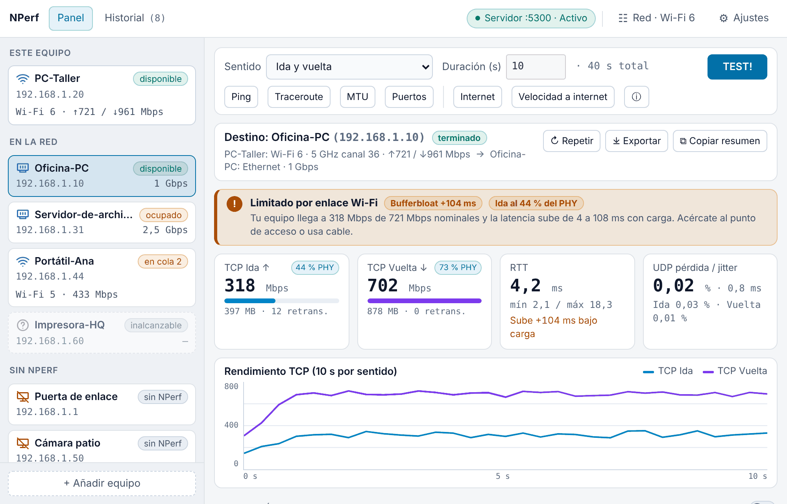

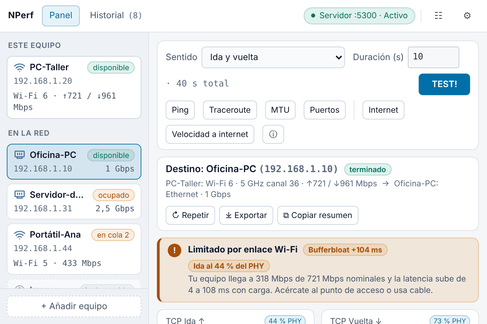

**oscuro**

### Panel en curso (fases, tiempo)

**claro**

**oscuro**

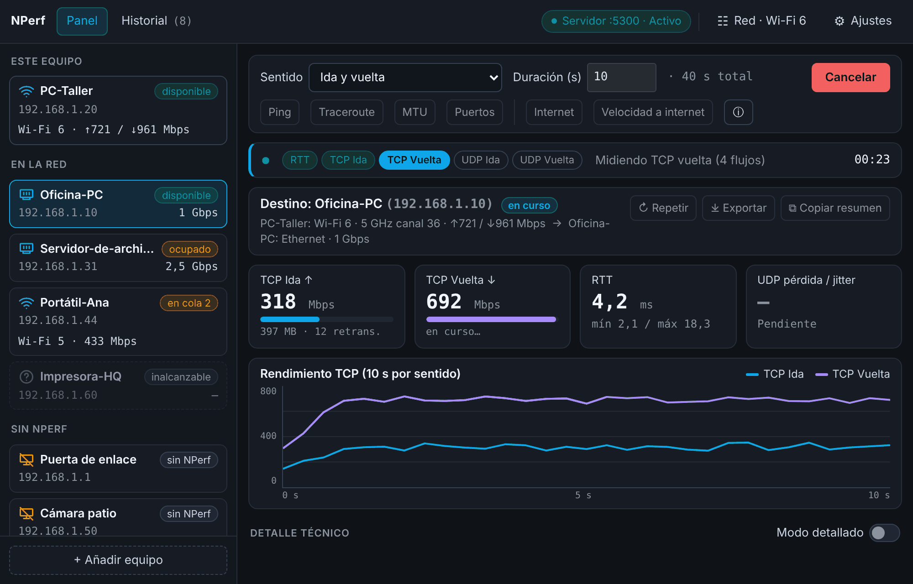

### Historial (filtros, lote, tabla)

**claro**

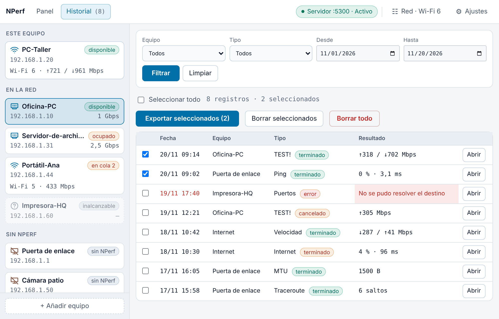

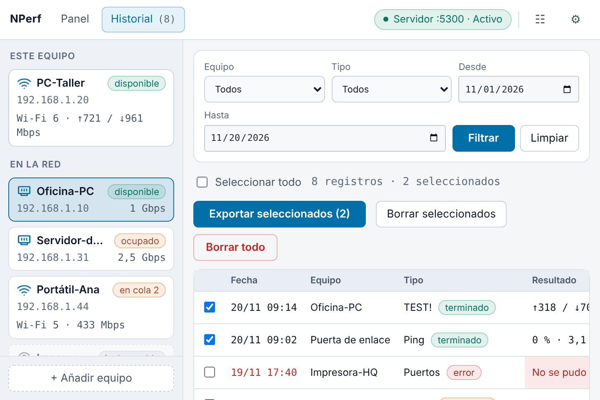

**oscuro**

### Drawer Tarjetas de red

**claro**

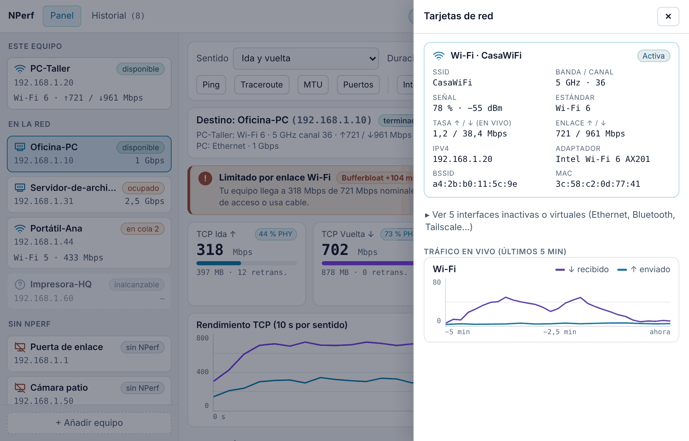

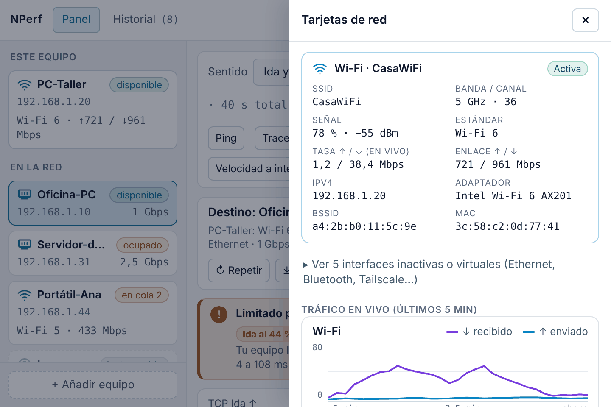

**oscuro**

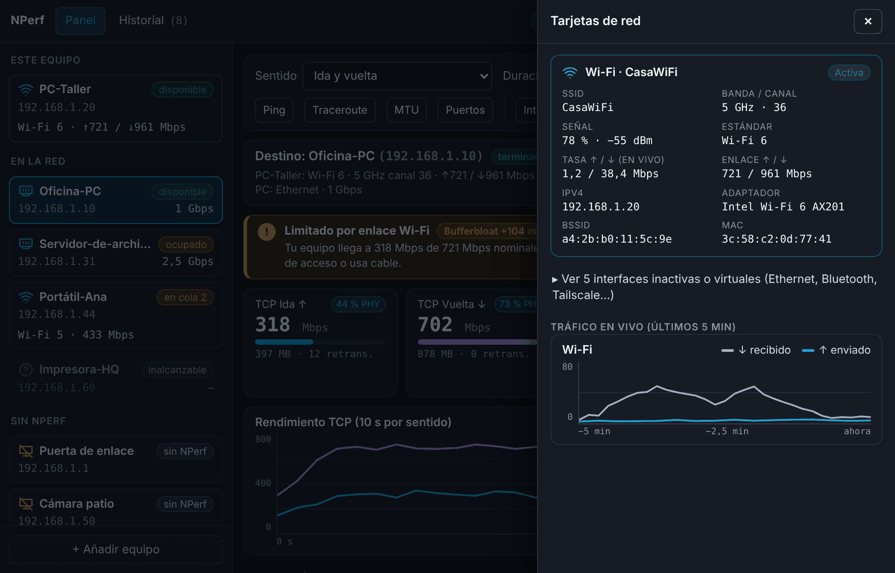

### Drawer Ajustes

**claro**

**oscuro**

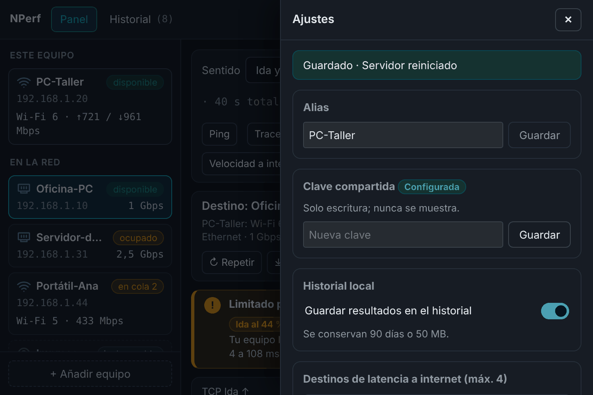

### Modal de consentimiento M-Lab

**claro**

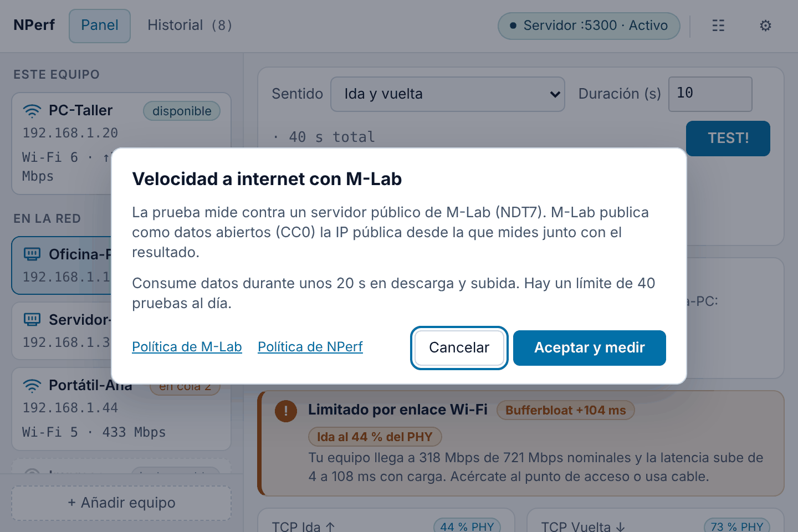

**oscuro**

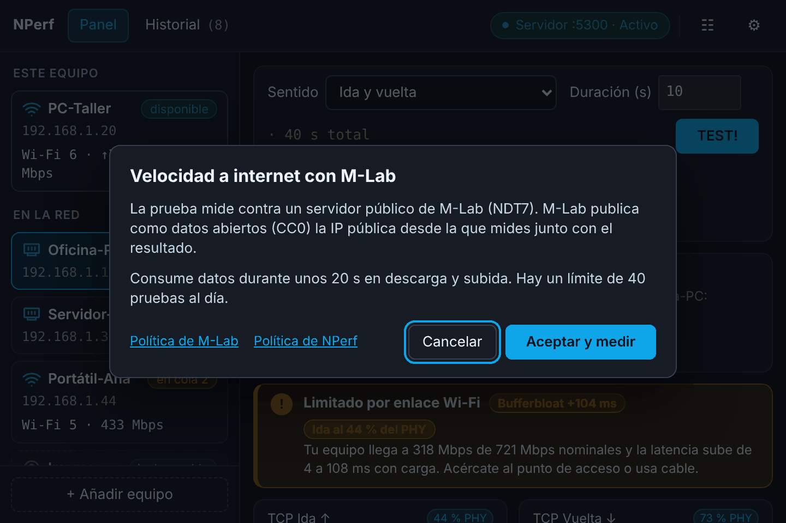

## Otros escenarios

Mismo patrón de nombre en `docs/img/gui-v2/<escenario>-<claro|oscuro>-<ancho>x<alto>.png`:

- `detallado`: Modo detallado
- `parcial`: TEST! cancelado (—, "No medido")
- `cola`: En cola
- `diagnostico`: Diagnóstico en curso
- `ping`: Resultado de Ping
- `internet`: Resultado de Internet
- `velocidad`: Resultado de velocidad
- `vacio`: Sin equipos + aviso de cortafuegos
- `anadir`: Mini-formulario Añadir equipo
- `sinhist`: Exportar deshabilitado con motivo (historial desactivado)
- `popover`: Popover ⓘ
- `historial-registro`: Registro en solo lectura
- `historial-desactivado`: Historial desactivado
- `exportar`: Modal de exportación
- `borrar`: Modal de borrado
- `red-inactivas`: Drawer Red con inactivas abiertas
- `ajustes-error`: Ajustes: error al guardar
- `error`: Servidor con error (config_error)

## Notas

- Las fuentes de las capturas son las de Linux (Cascadia Mono/Segoe UI no están): en Windows las cifras en mono serán algo más estrechas.
- Los iconos de los botones (↻ ⤓ ⧉ ⓘ ⚙) son glifos Unicode; el icono de "Red" es provisional.
- Las gráficas de la maqueta son SVG de ejemplo (ejes en HTML); la real usará `chart.js`.
