# Validación visual de la interfaz v2 (spec 008, T5: maqueta)

Maqueta estática: `tools/uipreview/maqueta.html` (+ `maqueta.js`), con el `app.css` y el `shell.js` reales. Ver con `go run ./tools/uipreview` y abrir `/maqueta` (selector de escenarios abajo a la izquierda, o `#escenario` en la URL; `?captura` lo oculta). **Pendiente de aprobación del usuario** (criterio 10).

## Comprobación automática

`NODE_PATH=$(npm root -g) node tools/uipreview/capturar.js` genera todas las capturas (claro y oscuro, 1000×640 y 720×480, factor 2) y comprueba:

- a 720×480: `document.documentElement.scrollWidth <= innerWidth` en los 24 escenarios;
- a 1000×640: la caja de `.kpis` y la de la gráfica (`getBoundingClientRect().bottom`) caben en `innerHeight` en resultado, modo detallado, sin historial, popover y modal.

Resultado: **OK** (sin scroll horizontal a 720×480; a 1000×640 KPI terminan en y=444 y la gráfica en y=620 de 640; con el aviso de "historial desactivado" la gráfica termina en 639, justo en el límite). Sin errores de consola.

## Escenarios principales

### Panel con resultado de TEST! (semáforo, 4 KPI, gráfica)

**claro**

**oscuro**

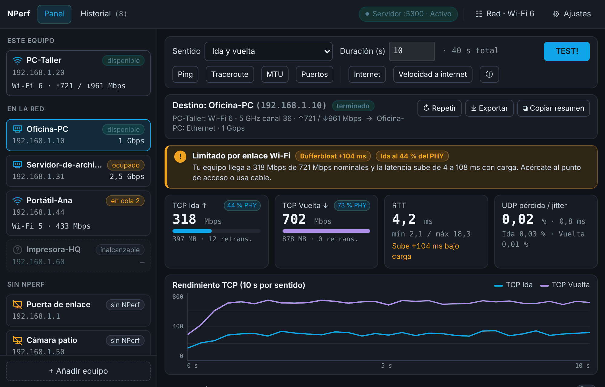

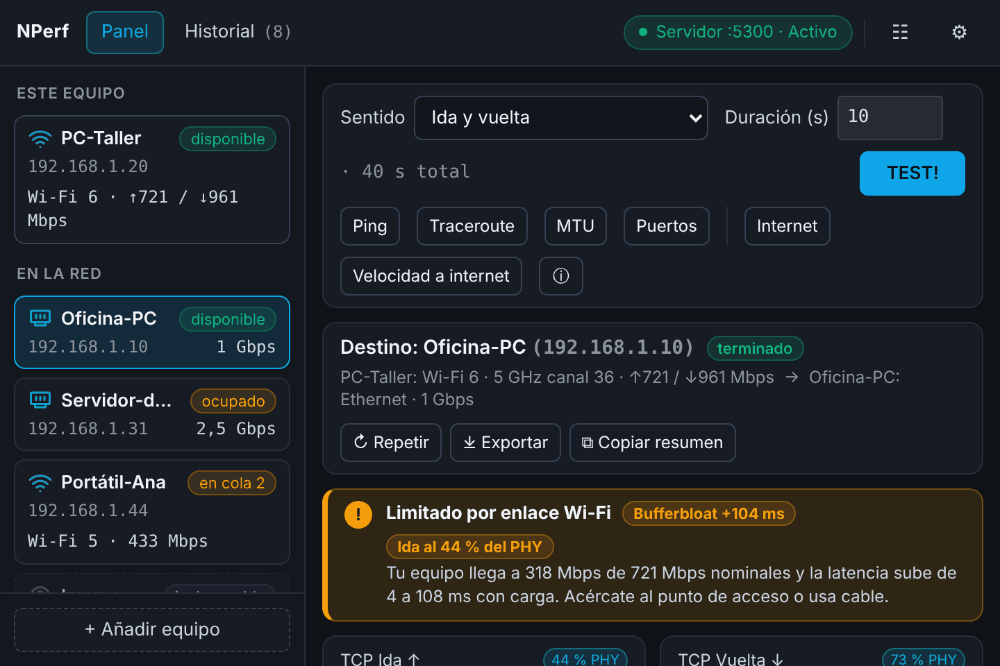

### Panel en curso (fases, tiempo)

**claro**

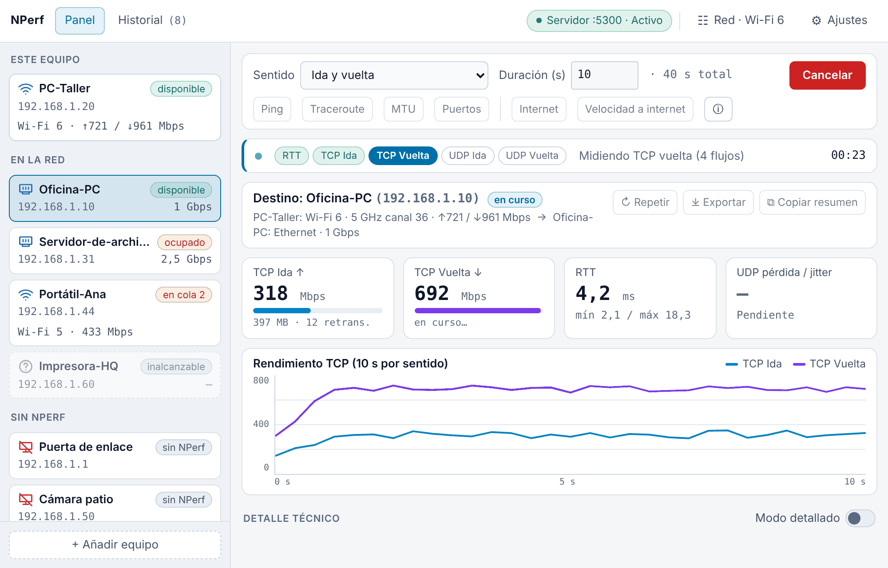

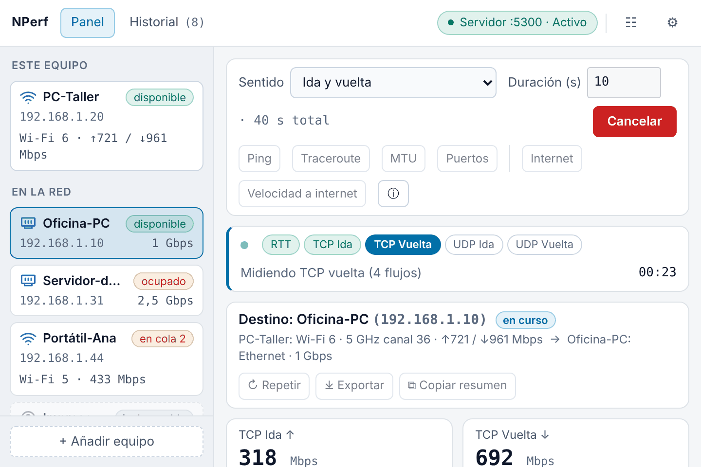

**oscuro**

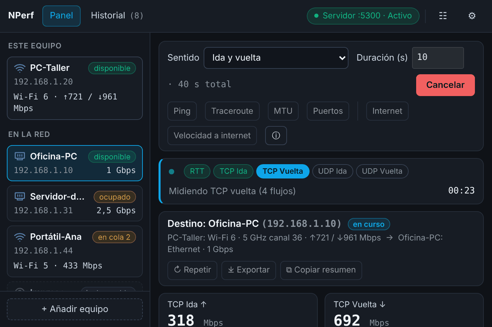

### Historial (filtros, lote, tabla)

**claro**

**oscuro**

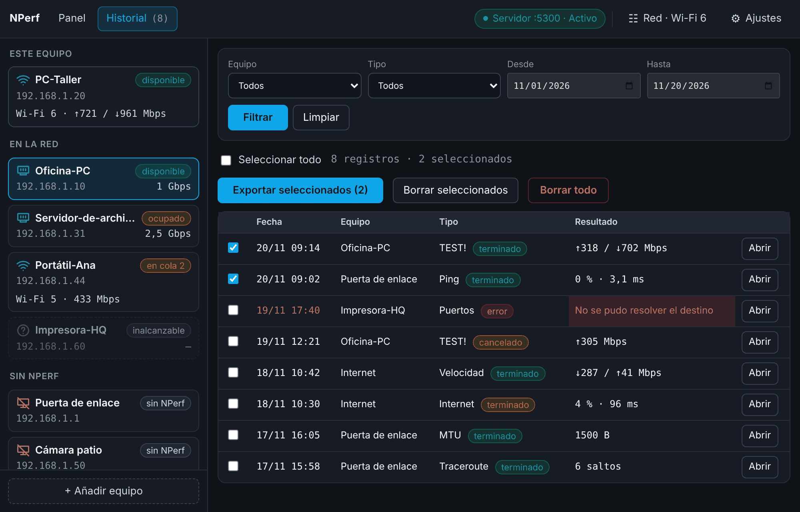

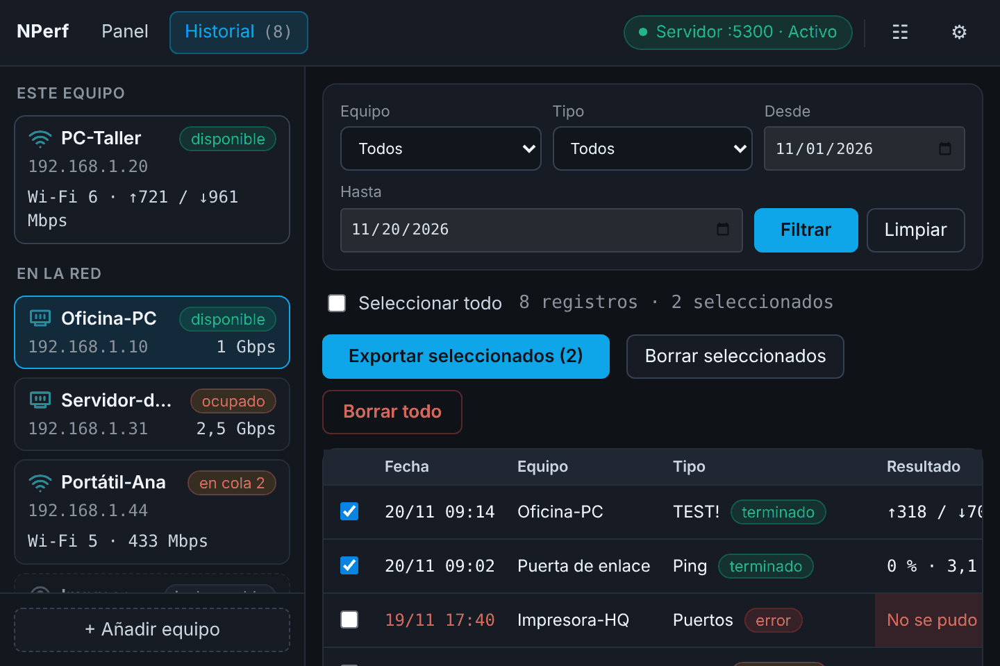

### Drawer Tarjetas de red

**claro**

**oscuro**

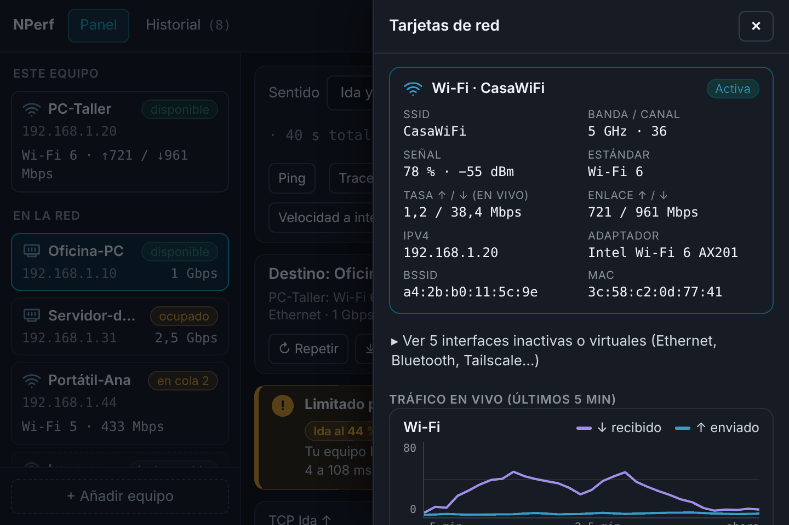

### Drawer Ajustes

**claro**

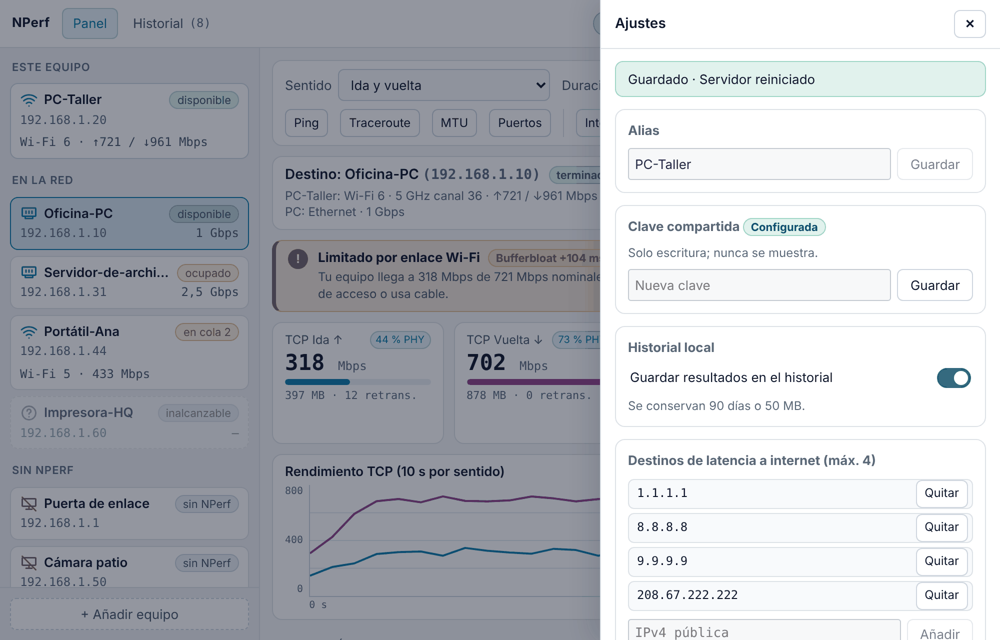

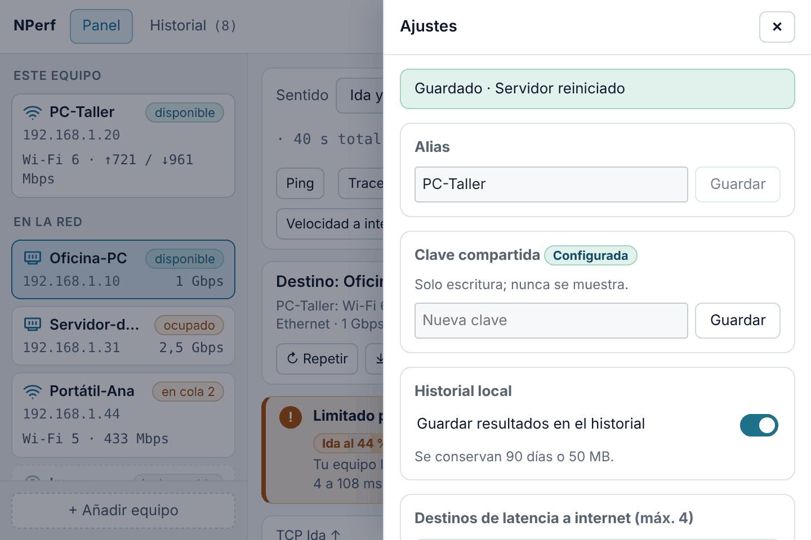

**oscuro**

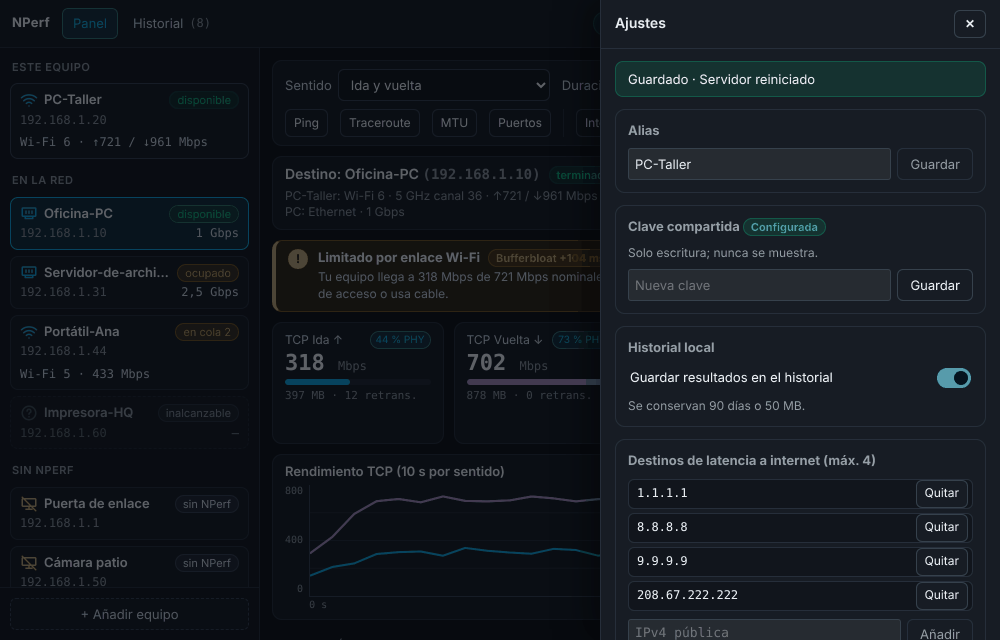

### Modal de consentimiento M-Lab

**claro**

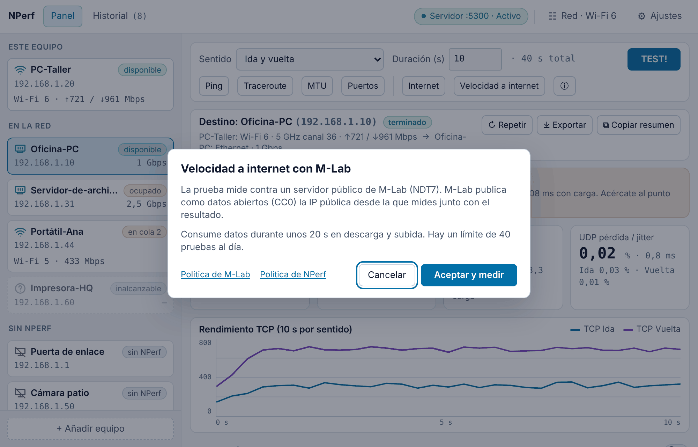

**oscuro**

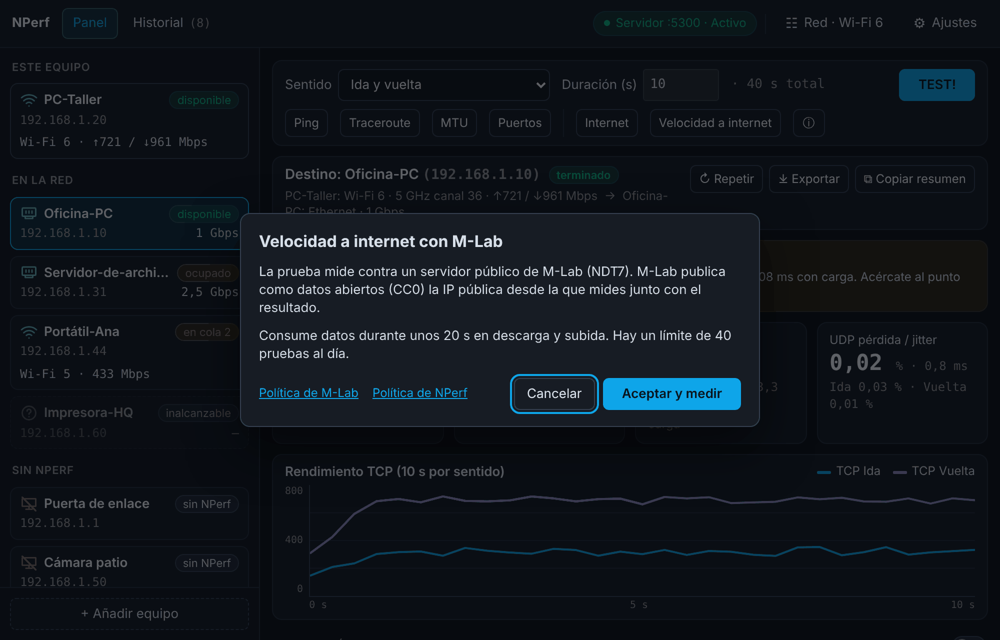

## Otros escenarios

Mismo patrón de nombre en `docs/img/gui-v2/<escenario>-<claro|oscuro>-<ancho>x<alto>.png`:

- `detallado`: Modo detallado
- `parcial`: TEST! cancelado (—, "No medido")
- `cola`: En cola
- `diagnostico`: Diagnóstico en curso
- `ping`: Resultado de Ping
- `internet`: Resultado de Internet
- `velocidad`: Resultado de velocidad
- `vacio`: Sin equipos + aviso de cortafuegos
- `anadir`: Mini-formulario Añadir equipo
- `sinhist`: Exportar deshabilitado con motivo (historial desactivado)
- `popover`: Popover ⓘ
- `historial-registro`: Registro en solo lectura
- `historial-desactivado`: Historial desactivado
- `exportar`: Modal de exportación
- `borrar`: Modal de borrado
- `red-inactivas`: Drawer Red con inactivas abiertas
- `ajustes-error`: Ajustes: error al guardar
- `error`: Servidor con error (config_error)

## Notas

- Las fuentes de las capturas son las de Linux (Cascadia Mono/Segoe UI no están): en Windows las cifras en mono serán algo más estrechas.
- Los iconos de los botones (↻ ⤓ ⧉ ⓘ ⚙) son glifos Unicode; el icono de "Red" es provisional.
- Las gráficas de la maqueta son SVG de ejemplo (ejes en HTML); la real usará `chart.js`.
